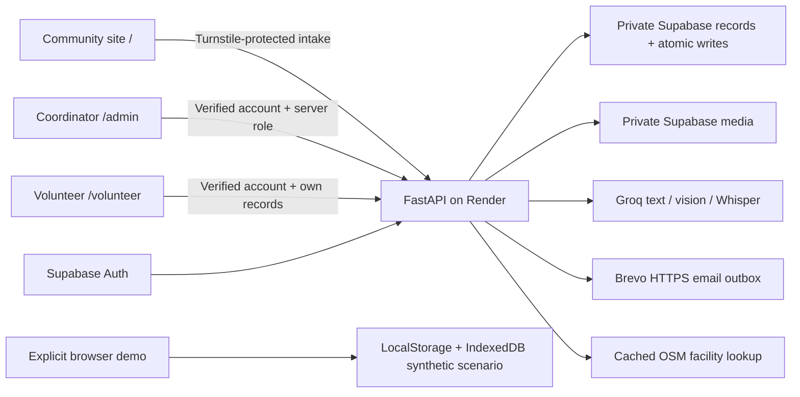

# Seva current architecture

Frontend: React/TypeScript with separate public, coordinator and volunteer routes. The interactive Leaflet map is lazy-loaded. Connected dashboard data is fetched in one role-scoped snapshot, refreshed once per minute only when visible. The service worker caches the app shell, not private data or map tiles.

Backend: explicit demo versus connected modes. Supabase verifies user access tokens; backend email allowlists grant coordinator access. Public anonymous intake returns only a receipt and validates Turnstile action/hostname in connected mode. Signed-in reports bypass public bot verification but require a verified identity.

Persistence: a small-pilot JSONB repository stores typed needs, volunteers, assignments, completions and mail outbox records. The service role is server-only; browser table permissions are revoked. Multi-record mutations use an atomic SQL function with optimistic revisions. MemoryRepository mirrors that interface for isolated tests/API demos.

Dispatch: cheap deterministic skill/proximity/reliability ranking is the default. Explicit AI enhancement uses only the configured provider and available candidates. A coordinator assigns a volunteer; the need and volunteer change together. One incident has one current assignment.

Evidence: active assignment ownership and valid image bytes are required. Vision can reject unrelated evidence or provide an estimate; missing provider/quota goes to manual review. A coordinator must approve or reject completion. Counts are derived from approved evidence, with an optional human-confirmed number; unknown counts remain excluded.

Offline: signed-in report records and files are stored in IndexedDB with an account ID and submission UUID. Reconnect/app-start replays only that user's queue; server idempotency prevents duplicate incidents. Public intake offers explicit device-local draft saving/restoration and requires a fresh security check before submitting. Closed-browser guaranteed background sync is not claimed.

The browser demo uses only synthetic seed records and locally entered demo content. It makes no private API requests, does not claim AI processing, and is not shared across devices. Demo portals share data only within the same browser/origin.

Earlier planning documents proposed Cloud SQL, Pub/Sub, pgvector and BigQuery. Those are not runtime dependencies of this implementation. Historical GCP adapters remain in source for reference but are not imported by the new application.

See [deployment and limitations](free-stack-deployment.md) for credentials, free-tier behavior, email retries, data migration and acceptance checks.
